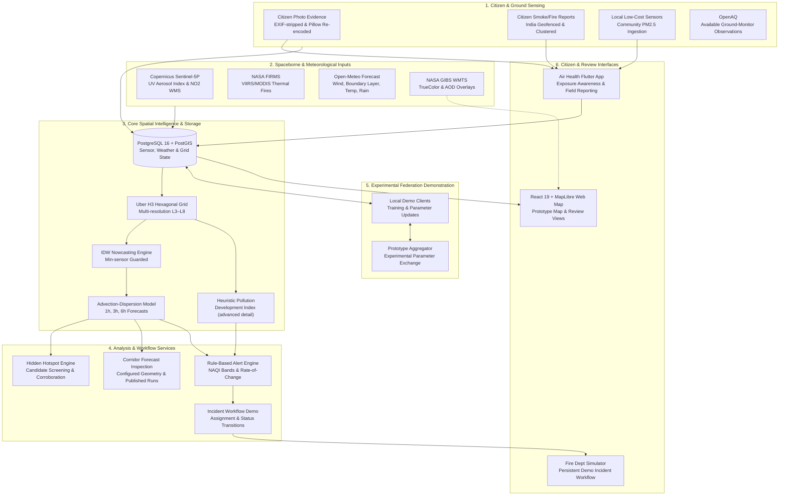

# Air Health — Hyper-Local Air-Quality Prototype

[](https://github.com/Hima-11-works/gdg-c4c/actions/workflows/pipeline.yml)


Air Health is a working prototype for exploring hyper-local air-quality signals in Indian cities. It combines available citizen, ground, satellite, and weather inputs on an H3 grid and provides forecast, evidence-review, and incident-simulation workflows. Source coverage varies; experimental model outputs are not production authority services, and parameter exchange is not a privacy guarantee.

Built for Google's **Code for Communities (GDG C4C)** Hackathon.

---

## 🎯 The Hackathon Problem & Challenge

### The Problem
> **Macro vs Hyper-Local Blindspots in Indian Air Quality**  
> Major Indian cities monitor macro-level air quality through a limited network of continuous ambient air quality monitoring stations (CAAQMS). However, they consistently miss hyper-local, high-consequence pollution events — unmonitored industrial emissions, large-scale agricultural stubble burning across Punjab, Haryana, and Western UP, brick kiln clusters, and sudden seasonal smog episodes. The absence of real-time, granular spatial data prevents coordinated, cross-jurisdictional climate action and directly threatens public health.

### The Challenge (problem statement)
> **An AI-Powered, Federated Climate Action Platform**  
> Build an interoperable climate action platform that combines citizen-sourced data (geotagged photos, local low-cost sensor readings) with satellite imagery and meteorological data. It must detect hidden pollution hotspots, forecast air quality spikes across major economic corridors, and alert relevant authorities for rapid intervention — designed for interoperability so Indian cities and states can share predictive models and coordinate emergency resources.

### 💡 How This Prototype Addresses the Challenge

| Challenge Requirement | How Our Prototype Addresses It | Shipped Artifacts & Systems |
|---|---|---|
| **Citizen Reports** | Flutter reporting flow for smoke/fire observations and optional photos. Backend image processing removes metadata before review. Sensitivity settings adjust general exposure-alert thresholds; they are not clinical advice. | Flutter Mobile App ([`air_health_flutter`](partner_apps/air_health_flutter/)), Photo Evidence API ([`docs/api/citizen-photos.md`](docs/api/citizen-photos.md)) |
| **Environmental Inputs** | Source adapters cover Copernicus Sentinel-5P, NASA FIRMS, OpenAQ, and Open-Meteo; availability and freshness depend on configuration and each source's cadence. Satellite products are not surface PM2.5 measurements. | Ingestion Pipeline (`app.ingestion`), Source Inventory ([`ENVIRONMENTAL_SOURCE_INVENTORY.md`](docs/ENVIRONMENTAL_SOURCE_INVENTORY.md)) |
| **Hotspot Review** | Candidate evidence can be assembled from available signals and reviewed by a person. A candidate is not a confirmed source or an automatic dispatch. | Hotspot Service (`app.services.hotspot_detection`), Hotspot Review Workflow ([`docs/api/hotspots.md`](docs/api/hotspots.md)) |
| **Corridor Forecast Inspection** | Displays backend-published forecasts for configured corridor geometry when a run is available. It does not schedule freight or recommend travel windows; evaluation status is shown with each run. | Corridor endpoints and evaluation ([`docs/api/corridor-evaluation.md`](docs/api/corridor-evaluation.md)) |
| **Incident Simulator** | Backend-backed incident records and status transitions for demonstration. The Flutter simulator does not contact emergency services or dispatch physical units. | Incident Engine (`app.services.incidents`), Simulator ([`fire_dept_simulator`](partner_apps/fire_dept_simulator/)), Incident API Contract ([`docs/api/incidents.md`](docs/api/incidents.md)) |
| **Federation Experiment** | Local partition and client/aggregator demonstrations. Participant identity is not agency-verified; model parameter exchange alone is not a privacy guarantee. | Federation Aggregator & Client CLI (`app.federation_*`), Federation Protocol ([`docs/api/federation.md`](docs/api/federation.md)) |

---

## 📑 Contents

- [System Architecture](#system-architecture)
- [Subsystem Documentation](#-subsystem-documentation)
- [Key Platform Pillars](#key-platform-pillars)
- [Granular Spatial Grid & Map](#granular-spatial-grid--map)
- [Environmental Data Sources](#environmental-data-sources)
- [Partner Mobile Apps & Ready-to-Install APKs](#partner-mobile-apps--ready-to-install-apks)
- [Quick Start](#quick-start)
- [Live Pipeline & Scheduled Ingestion](#live-pipeline--scheduled-ingestion)
- [CLI Tooling & Operational Commands](#cli-tooling--operational-commands)
- [Experimental Federation Demonstration](#experimental-federation-demonstration)
- [API Index & Contracts](#api-index--contracts)
- [Google AI Integration](#google-ai-integration)
- [Development & Testing](#development--testing)
- [Limits & Operational Roadmap](#limits--operational-roadmap)
- [Repository Guide](#repository-guide)

---

## 📚 Subsystem Documentation

For in-depth component-level guides, architectural deep-dives, and setup instructions, refer to the dedicated READMEs:

| Subsystem | Stack | Description | Dedicated Guide |
|---|---|---|:---:|
| 📊 **Hackathon Pitch Deck** | 12-Slide Deck · Speaker Script · Rubric Map | Official 10–12 slide presentation deck, visual diagrams, and speaker notes | [**Pitch Deck Guide**](docs/PITCH_DECK.md) |
| 🖥️ **Web Dashboard** | React 19 · TypeScript · MapLibre GL | H3 spatial explorer, published-run inspection, and hotspot review | [**Frontend Guide**](frontend/README.md) |
| ⚙️ **Backend Core & Pipeline** | FastAPI · PostgreSQL/PostGIS · Uber H3 · Python 3.11+ | Spatial nowcasting, advection-dispersion forecasting, satellite fusion, and REST API | [**Backend Guide**](backend/README.md) |
| 📱 **Air Health Citizen App** | Flutter · Riverpod | Exposure awareness, reports, user-selected thresholds, and relative nearby estimates | [**Air Health App Guide**](partner_apps/air_health_flutter/README.md) |
| 🚒 **Fire Dept Simulator** | Flutter · Native `dart:io` | Backend-connected incident workflow demonstration; no physical dispatch | [**Fire Dept Simulator Guide**](partner_apps/fire_dept_simulator/README.md) |

---

## 🏛️ System Architecture



---

## 🚀 Key Platform Pillars

### 1. 🔍 Hotspot Candidate Review
The backend can assemble candidate evidence from available satellite context, thermal detections, citizen reports, and sensor readings. A candidate is an unverified signal for human review; the app does not confirm an emission source or automatically dispatch responders.

### 2. 🚚 Corridor Forecast Inspection
The dashboard displays forecasts from a published backend run when available, along configured corridor geometry. Geometry may be illustrative. The view does not schedule freight, predict travel delays or visibility, or recommend a transit window. Evaluation status and run provenance are shown where recorded.

### 3. 📱 Citizen Reporting & Exposure Awareness
The Flutter companion supports smoke/fire reports, optional photos, community sensor input, and user-selected exposure-alert thresholds. These alerts are general environmental information, not medical advice. Nearby AQI estimates may be incomplete or stale and are not safety ratings or relocation recommendations. The offline gazetteer resolves known place names; unresolved cells may show a shortened cell label.

### 4. 🚨 Incident Simulation
The simulator reads backend incidents and records allowed status transitions for demonstration. It does not contact emergency services or dispatch physical units. The backend has a separate optional authority-webhook workflow, which should only be described as active when its receiving endpoint is configured and verified.

### 5. 🤝 Federation Experiment
The repository includes a local partition demo and an optional multi-process client/aggregator workflow. Demo data may be synthetic, and participant identities are not independently verified as agencies. Exchanging fitted parameters is not differential privacy or a general privacy guarantee; see [`docs/api/federation.md`](docs/api/federation.md) for limits.

---
---

## 🗺️ Granular Spatial Grid & Map

The web application uses the **Uber H3 Discrete Global Grid System** to discretize spatial pollution fields. As users explore, the viewport dynamically adapts its H3 resolution:

| Map Level | Viewport Zoom | H3 Resolution | Hex Cell Diameter | Requested Coverage |
|:---:|:---:|:---:|:---:|---|
| **Level 1** | `< 6` | **H3 Res 3** | ~110 km | National India overview (aggregated OpenAQ stations) |
| **Level 2** | `6 to < 7` | **H3 Res 4** | ~41 km | Dynamic viewport boundary |
| **Level 3** | `7 to < 9` | **H3 Res 5** | ~16 km | State-level focus & major industrial corridors |
| **Level 4** | `9 to < 10.5` | **H3 Res 6** | ~6 km | District / Municipal Corporation view |
| **Level 5** | `10.5 to 12` | **H3 Res 7** | ~2.2 km | Hyper-local ward & neighborhood analysis |

- **Layer Controls**: Toggle between discrete H3 hexagons and continuous IDW-interpolated heat surfaces.
- **Advanced Cell Detail**: The heuristic PDI remains available as a collapsed, caveated cell detail; it is not a map overlay.
- **Overlays**: Wind vectors from the configured weather feed, available NASA FIRMS thermal detections, citizen photo markers, active incidents, and date-stamped NASA GIBS satellite context products.

---

## 📊 Environmental Data Sources

| Source | Role in Platform | Provenance & Access |
|---|---|---|
| [**OpenAQ**](https://openaq.org/) | Ground-level PM2.5 observations | Public station observations where available and configured |
| [**Open-Meteo**](https://open-meteo.com/) | High-resolution meteorological data | Wind speed/direction, temperature, precipitation, boundary layer height |
| [**Copernicus CDSE**](https://dataspace.copernicus.eu/) | Sentinel-5P UV Aerosol Index (UVAI) & NO2 | Screening for elevated smoke and industrial plumes |
| [**NASA FIRMS**](https://firms.modaps.eosdis.nasa.gov/) | VIIRS / MODIS satellite fire anomalies | Rapid corroboration of agricultural stubble burning and industrial flares |
| [**NASA GIBS**](https://wiki.earthdata.nasa.gov/display/GIBS) | Satellite imagery and AOD products | Visual context via backend proxy; product date and cadence vary |
| [**geoBoundaries**](https://www.geoboundaries.org/) | Administrative boundary hierarchies | Official India State and District boundaries (ODC-ODbL) |
| [**GeoNames**](https://www.geonames.org/) | Geographic gazetteer | Fast location search across Indian towns and cities (CC BY 4.0) |

*Full licensing, retention, and fallbacks are documented in [`docs/ENVIRONMENTAL_SOURCE_INVENTORY.md`](docs/ENVIRONMENTAL_SOURCE_INVENTORY.md).*

---

## 📱 Partner Mobile Apps & Ready-to-Install APKs

Pre-built release APKs are available directly in [`apks/`](apks/) for immediate testing on Android devices:

| Mobile Application | Description | Architecture | Download Link |
|---|---|---|---|
| **Air Health Companion** | Exposure awareness, user-selected thresholds, audio alerts, photo and sensor reporting | **ARM 64-bit** (Modern Phones)<br/>**ARM 32-bit**<br/>Universal Fat APK | [Download ARM64](apks/air_health_flutter-arm64.apk)<br/>[Download ARM32](apks/air_health_flutter-arm32.apk)<br/>[Download Universal](apks/air_health_flutter-release.apk) |
| **Fire Dept Simulator** | Backend-connected incident workflow demonstration; no physical dispatch | **ARM 64-bit** (Modern Phones)<br/>**ARM 32-bit**<br/>Universal Fat APK | [Download ARM64](apks/fire_dept_simulator-arm64.apk)<br/>[Download ARM32](apks/fire_dept_simulator-arm32.apk)<br/>[Download Universal](apks/fire_dept_simulator-release.apk) |

### Installing via ADB:
```bash
# Install the citizen companion app
adb install apks/air_health_flutter-arm64.apk

# Install the fire department response console
adb install apks/fire_dept_simulator-arm64.apk
```

---

## ⚡ Quick Start

### Prerequisites
- **Docker Desktop** (with Compose v2)
- **Node.js** (`^20.19.0` or `>=22.12.0`)
- **Python** `3.11+` (optional for local non-Docker development)
- **Git**

### Step-by-Step Local Deployment

1. **Clone the repository:**
   ```bash
   git clone https://github.com/Hima-11-works/gdg-c4c.git
   cd gdg-c4c
   ```

2. **Set up environment configurations:**
   ```powershell
   Copy-Item .env.example .env
   Copy-Item frontend/.env.example frontend/.env
   ```
   *`.env.example` defaults to live mode. To run the synthetic walkthrough, set `DEMO_MODE=true` in `.env` before starting the API and pipeline. Live mode returns empty/unavailable results until it has a live publication; it does not fill gaps with demo values.*

3. **Start PostgreSQL + PostGIS and FastAPI Backend:**
   ```bash
   docker compose up --build -d
   ```
   *The backend applies database migrations automatically on startup.*

4. **For the demo walkthrough, enable demo mode and trigger the initial pipeline:**
   ```bash
   docker compose exec api python -m app.pipeline.run
   ```

5. **Start the React + MapLibre Web Map:**
   ```bash
   cd frontend
   npm ci
   npm run dev
   ```

6. **Access the Interfaces:**
   - 🌐 **Web Map Explorer**: [http://localhost:5173](http://localhost:5173)
   - 📖 **Interactive API Documentation (Swagger)**: [http://localhost:8000/docs](http://localhost:8000/docs)
   - 🩺 **Health Check**: [http://localhost:8000/health/ready](http://localhost:8000/health/ready)

---

## 🔄 Live Pipeline & Scheduled Ingestion

To enable configured external source ingestion, populate the following credentials in your root `.env`. The workflow runs on its configured schedule; it is not a real-time satellite feed:

```env
DEMO_MODE=false
OPENAQ_API_KEY=your_openaq_api_key
CDSE_REFRESH_TOKEN=your_copernicus_data_space_token
CDSE_SECRET_ENCRYPTION_KEY=your_fernet_key_from_cryptography_fernet_Fernet_generate_key
FIRMS_MAP_KEY=your_nasa_firms_map_key
INGEST_BBOX_MIN_LAT=28.40
INGEST_BBOX_MIN_LON=76.80
INGEST_BBOX_MAX_LAT=28.90
INGEST_BBOX_MAX_LON=77.50
```

- **Scheduled collection**: The workflow in [`.github/workflows/pipeline.yml`](.github/workflows/pipeline.yml) wakes due collector jobs every five minutes; GitHub may delay scheduled runs, and satellite coverage still depends on overpass and product publication.
- **Satellite credentials**: Generate `CDSE_SECRET_ENCRYPTION_KEY` with `python -c "from cryptography.fernet import Fernet; print(Fernet.generate_key().decode())"` and store it with `CDSE_REFRESH_TOKEN` as a deployment secret. The database stores rotated refresh tokens only as Fernet ciphertext. Keep the same key available to the worker and API; re-encrypt stored credentials with the old key before changing it.
- **Manual Pipeline Trigger**:
  ```bash
  docker compose exec api python -m app.pipeline.run
  ```

---

## 🛠️ CLI Tooling & Operational Commands

The backend includes a feature-rich CLI for operations, evaluations, and data management:

| Command | Description | Example Usage |
|---|---|---|
| `python -m app.pipeline.run` | Run the complete multi-stage pipeline end-to-end | `python -m app.pipeline.run` |
| `python -m app.cli ingest` | Ingest CAAQMS PM2.5 station observations | `python -m app.cli ingest` |
| `python -m app.cli ingest-weather` | Ingest Open-Meteo weather features across H3 | `python -m app.cli ingest-weather` |
| `python -m app.cli ingest-fires` | Ingest NASA FIRMS VIIRS fire anomalies | `python -m app.cli ingest-fires --days 1` |
| `python -m app.cli forecast` | Run the Deterministic H3 Advection-Dispersion model | `python -m app.cli forecast` |
| `python -m app.cli hotspot-scan` | Run candidate-hotspot detector over case fixtures | `python -m app.cli hotspot-scan --fixture tests/fixtures/hotspots/positive_hotspot.json` |
| `python -m app.cli corridor-evaluate` | Score corridor forecast against real withheld stations | `python -m app.cli corridor-evaluate --corridor delhi-kanpur` |
| `python -m app.cli verify-media-storage` | Test and verify citizen photo evidence store | `python -m app.cli verify-media-storage --sweep-expired` |
| `python -m app.cli expire-reports` | Sweep and persist expired status for citizen reports | `python -m app.cli expire-reports` |
| `python -m app.cli federation-demo` | Run local multi-party federated model demo | `python -m app.cli federation-demo` |

---

## 🌐 Experimental Federation Demonstration

The repository includes an experimental local federation workflow. It demonstrates model update exchange but does not establish privacy guarantees or participation by real agencies:

### Two-Partition Local Demo
Simulates two local partitions training and aggregating models:
```bash
# In backend environment:
python -m app.cli federation-demo
```
Inspect public status:
```bash
curl http://localhost:8000/api/v1/federation/status
```

### Multi-Process Client/Aggregator Workflow
Run an independent aggregator and two separate client processes with local demo or test inputs:
```powershell
# 1. Start central model aggregator:
python -m app.federation_aggregator --port 8010 --run-id fed-run-01 --client-keys var/federation/client_keys.json

# 2. Start demo Client A:
python -m app.federation_client --participant region-a --aggregator-url http://localhost:8010

# 3. Start demo Client B:
python -m app.federation_client --participant region-b --aggregator-url http://localhost:8010
```
*Full protocol specification in [`docs/api/federation.md`](docs/api/federation.md).*

---

## 🔌 API Index & Contracts

### Prediction & Environmental Grid APIs (v2)

| Method & Route | Description | Contract & Notes |
|---|---|---|
| `GET /api/v2/grid/current` | Active H3 grid cells with nowcasted PM2.5, PDI, confidence, and bounds | [Architecture Specification](docs/architecture.md) |
| `GET /api/v2/grid/forecast` | Advection-dispersion forecast fields (1h, 3h, 6h horizons) | [Architecture Specification](docs/architecture.md) |
| `GET /api/v2/cells/{h3_cell}` | Cell detail view: time series, weather features, land-use, and population exposure | [Architecture Specification](docs/architecture.md) |
| `GET /api/v2/weather` | Weather grid across H3 cells (wind u/v, boundary layer height, temperature, humidity) | [Architecture Specification](docs/architecture.md) |
| `GET /api/v2/alerts` | Published warning/critical alerts classified by NAQI bands | [Architecture Specification](docs/architecture.md) |
| `GET /api/v2/exposure` | Population-weighted PM2.5 exposure and high-risk headcount metrics | [Architecture Specification](docs/architecture.md) |
| `GET /api/v2/meta` | Published run metadata, native resolution, data mode, and upstream source health | [Architecture Specification](docs/architecture.md) |

### Hotspots & Corridors (v1)

| Method & Route | Description | Contract & Notes |
|---|---|---|
| `GET /api/v1/hotspots` | Satellite UVAI + FIRMS hotspot candidates awaiting review | [Hotspots Contract](docs/api/hotspots.md) |
| `GET /api/v1/corridors` | List named economic corridors (`delhi-kanpur`, `dmic`, `edfc`) | [Corridor Contract](docs/api/corridor-evaluation.md) |
| `GET /api/v1/corridors/{id}/evaluation` | Published corridor-run evaluation and validation status | [Corridor Contract](docs/api/corridor-evaluation.md) |

### Citizen Science, Photos & Sensors

| Method & Route | Description | Contract & Notes |
|---|---|---|
| `POST /api/v1/reports` | Submit citizen smoke/fire report (India geofenced, auto-clustered) | [Reports Contract](docs/api/citizen-reports.md) |
| `GET /api/v1/reports/{id}` | Read individual report standing and lifecycle status | [Reports Contract](docs/api/citizen-reports.md) |
| `POST /api/v1/reports/{id}/moderation` | Authority moderation (`corroborated` / `rejected`), reviewer-key gated | [Reports Contract](docs/api/citizen-reports.md) |
| `POST /reports/{id}/evidence` | Attach photo evidence (content sniffed, EXIF stripped, raster re-encoded) | [Photos Contract](docs/api/citizen-photos.md) |
| `GET /reports/{id}/evidence/{eid}/derivative` | Reviewer-only access to sanitized photo derivative bytes | [Photos Contract](docs/api/citizen-photos.md) |
| `POST /api/v1/sensors/citizen` | Ingest crowdsourced community PM2.5 reading for authority review | [Sensors Contract](docs/api/citizen-sensor-readings.md) |
| `GET /api/v1/sensors/citizen` | Authority queue for pending citizen sensor submissions | [Sensors Contract](docs/api/citizen-sensor-readings.md) |
| `POST /api/v1/sensors/citizen/{id}/review` | Verify or reject citizen sensor reading | [Sensors Contract](docs/api/citizen-sensor-readings.md) |

### Incidents & Satellite Raster Proxies

| Method & Route | Description | Contract & Notes |
|---|---|---|
| `GET /api/v1/incidents` | Backend incident workflow queue used by the simulator | [Incidents Contract](docs/api/incidents.md) |
| `POST /api/v1/incidents` | Instantiate incident from published alert, fire report, or hotspot | [Incidents Contract](docs/api/incidents.md) |
| `POST /api/v1/incidents/{id}/transition` | Progress incident state (`ACKNOWLEDGED` → `EN ROUTE` → `ON SCENE` → `RESOLVED`) | [Incidents Contract](docs/api/incidents.md) |
| `GET /api/v1/tiles/gibs/{layer}/availability?min_lat=&min_lon=&max_lat=&max_lon=` | Newest GIBS date with responding sample tiles for the visible map area | [Source Inventory](docs/ENVIRONMENTAL_SOURCE_INVENTORY.md) |
| `GET /api/v1/tiles/gibs/{layer}/{z}/{y}/{x}?date=` | NASA GIBS TrueColor or Deep Blue AOD raster tile; defaults to the latest WMTS-advertised date | [Source Inventory](docs/ENVIRONMENTAL_SOURCE_INVENTORY.md) |
| `GET /api/v1/tiles/no2/{z}/{y}/{x}` | Proxied Sentinel-5P NO2 WMS tile when a backend endpoint is configured | [Source Inventory](docs/ENVIRONMENTAL_SOURCE_INVENTORY.md) |
| `GET /api/v1/federation/status` | Recorded status for the configured federation demonstration | [Federation Contract](docs/api/federation.md) |

---

## Google AI Integration

The implemented Google AI feature is Gemini-powered advisory interpretation of submitted report photos. It cannot infer AQI or pollutant concentration, confirm the pollution source, approve a report, or dispatch responders. See [`docs/GOOGLE_STACK_INTEGRATION.md`](docs/GOOGLE_STACK_INTEGRATION.md) for its constraints and setup.

---

## 🛠️ Development & Testing

### Backend (Python 3.11+)
```bash
cd backend
python -m venv .venv
# Activate: .venv\Scripts\Activate.ps1 (Windows) or source .venv/bin/activate (Linux/macOS)
pip install -e ".[dev]"
alembic upgrade head
pytest
ruff check .
```

### Frontend (React 19 + TypeScript + MapLibre)
```bash
cd frontend
npm ci
npm run lint
npm run build
```

### Flutter Partner Apps
```bash
# Air Health Companion
cd partner_apps/air_health_flutter
flutter analyze
flutter test

# Fire Department Incident Simulator
cd ../fire_dept_simulator
flutter analyze
flutter test
```

---

## ⚠️ Prototype Limits

1. **Coverage and freshness**: Ground, satellite, weather, and citizen coverage varies by source configuration, location, and update cadence.
2. **Satellite interpretation**: Sentinel-5P UVAI is a column aerosol screening signal, not surface PM2.5. Candidate evidence remains unverified until a person reviews it.
3. **Forecasting scope**: Forecast methods are experimental and should be evaluated against independently held-out observations before operational use.
4. **Federation scope**: Local demos and client/aggregator workflows do not establish agency participation or privacy guarantees. Parameter exchange is not differential privacy.

See [`docs/GO_LIVE.md`](docs/GO_LIVE.md) for the pre-deployment checklist and operational safety procedures.

---

## 📂 Repository Guide

```text
├── .github/workflows/          # CI/CD and hourly scheduled ingestion pipeline
├── apks/                       # Pre-compiled Android release APKs (ARM64, ARM32, Universal)
│   ├── air_health_flutter-*.apk # Citizen exposure-awareness release builds
│   └── fire_dept_simulator-*.apk # Incident-workflow simulator release builds
├── backend/                    # FastAPI service, SQLAlchemy/PostGIS models, pipeline
│   │                           # 📖 See backend/README.md for dedicated guide
│   ├── alembic/                # Database migrations for PostgreSQL + PostGIS schema
│   ├── app/
│   │   ├── api/                # REST endpoints (grid v2, alerts, hotspots, corridors, etc.)
│   │   ├── domain/             # Core domain models, H3 protocols, lifecycle states
│   │   ├── ingestion/          # OpenAQ, Open-Meteo, NASA FIRMS, CDSE Sentinel-5P adapters
│   │   ├── pipeline/           # Composition runner for hourly spatial processing
│   │   ├── services/           # Dispersion modeling, heuristic PDI, incidents, evidence
│   │   └── federation_*        # Federated learning client and aggregator modules
│   └── tests/                  # Unit, regression, and architecture contract tests
├── frontend/                   # React 19 web application (MapLibre, H3 grid)
│   │                           # 📖 See frontend/README.md for dedicated guide
│   ├── src/components/         # Map view, corridor panel, hotspot panel, timeline, alerts
│   └── src/lib/                # Level of Detail (LOD) calculations, color scales, API hooks
├── partner_apps/               # Flutter cross-platform mobile apps
│   ├── air_health_flutter/     # Citizen exposure awareness & field reporting app
│   │                           # 📖 See partner_apps/air_health_flutter/README.md
│   └── fire_dept_simulator/    # Backend-connected incident workflow simulator
│                               # 📖 See partner_apps/fire_dept_simulator/README.md
├── docs/                       # Architecture specifications and API contracts
│   ├── PITCH_DECK.md           # 📊 Official 12-slide hackathon pitch deck & speaker notes
│   ├── api/                    # OpenAPI contracts (hotspots, corridors, federation, etc.)
│   ├── architecture.md         # In-depth architectural blueprint
│   ├── GO_LIVE.md              # Production deployment checklist
│   ├── GOOGLE_STACK_INTEGRATION.md # Gemini, Firebase, Google Maps roadmap
│   └── ENVIRONMENTAL_SOURCE_INVENTORY.md # Sensor & satellite provenance details
└── docker-compose.yml          # Container configuration for API and PostGIS database
```

---

*Air Health — A working prototype for reviewing hyper-local air-quality signals and demonstrating climate-response workflows.*
