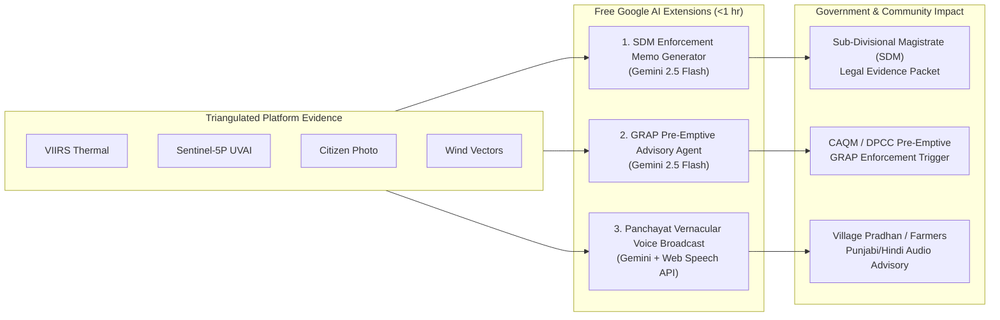

# Air Health: Hackathon Strategy, Streamlined Feature Audit & Google AI Roadmap

> **Track:** Clean Air and Climate Resilience (Theme: Sustainability)  
> **Competition:** Google Developer Groups (GDG) Code for Communities (C4C)  
> **Target Institutions:** Commission for Air Quality Management (CAQM), Central Pollution Control Board (CPCB), State Pollution Control Boards (Punjab PPCB, Haryana HSPCB, Delhi DPCC), District Administrations / Parali Protection Forces.

---

## Executive Summary

This document outlines the focused hackathon roadmap and technical audit for **Air Health (`gdg-c4c`)**. Based on the **GDG C4C Evaluation Parameters** (25% AI Execution, 20% Problem-Solution Fit, 20% Depth & Reach Across India, 20% Deployability & Scalability, 15% Impact Potential), this strategy eliminates high-risk, unfeasible items and prioritizes **100% free, fast-to-implement Google AI extensions** that solve real operational bottlenecks.

Crucially, it frames the project not merely as an academic exercise or another passive AQI map, but as an **institutionally sellable, legally defensible, closed-loop enforcement platform** designed to solve two core administrative crises:
1. **The Twilight Enforcement Gap:** Stubble burning peaks between 4:00 PM and 7:00 PM when polar satellites are blind.
2. **The Inter-State Legal Impasse:** Political and jurisdictional resistance between Punjab, Haryana, and Delhi against sharing raw sensor data, solved via Federated Learning.

---

## Part 1: Streamlined Feature Audit & Actionability Status

We have audited the candidate features against strict feasibility criteria: **zero recurring cost**, **under 1 hour implementation time**, and **maximum scoring impact with judges and government regulators**.

| # | Feature | Status | In Codebase | Streamlined Action Plan |
|---|---|:---:|---|---|
| **1** | **Evening-Fire Multi-Source Triangulation** *(Satellite + citizen + wind vectors)* | 🟢 **Active Core (~75%)** | [`hotspot_detection.py`](backend/app/services/hotspot_detection.py) fuses VIIRS FIRMS thermal anomalies, Sentinel-5P UVAI passes, ground PM2.5, citizen reports, and wind azimuth. | **Kept as Core.** Rely on physics-based triangulation without expensive third-party satellite feeds. |
| **2** | **Gemini Photo Verification & Source Attribution** *(Multimodal visual forensics)* | 🟢 **Active Core (~80%)** | [`gemini_assessment.py`](backend/app/services/gemini_assessment.py) uses Gemini Multimodal (`gemini-2.5-flash`) for structured source categorization (`smoke`, `fire`, `industrial plume`, visual uncertainty). | **Kept as Core.** Verified evidence feeds directly into administrative workflows. |
| **3** | **Trust Layer with Defensible Uncertainty** *(Calibration, uncertainty intervals)* | 🟢 **Active Core (~85%)** | [`prediction_queries.py`](backend/app/services/prediction_queries.py) provides confidence & uncertainty bounds; [`citizen_calibration.py`](backend/app/services/citizen_calibration.py) handles optical hygroscopic adjustment. | **Kept as Core.** Provides legal confidence intervals required by regulators. |
| **4** | **Inter-State Federated Learning (Punjab/Haryana/Delhi)** *(Privacy-preserving model aggregation)* | 🟢 **Active Core (~90%)** | [`federation.py`](backend/app/services/federation.py) and CLI `app.cli federation-demo` train local ridge residual models per state, exchanging only model weights. | **Kept as Core.** Solves data sovereignty and powers cross-border cooperation. |
| **5** | **Closed-Loop Detection-to-Action Ticketing** *(Dispatch, responder workflow, audit trail)* | 🟢 **Active Core (~85%)** | [`incidents.py`](backend/app/services/incidents.py) and [`partner_apps/fire_dept_simulator`](partner_apps/fire_dept_simulator) provide role-scoped incident states and append-only audit trail. | **Kept as Core.** Completes the loop from detection to boots-on-the-ground. |
| **6** | **GRAP Stage Pre-Emptive Advisory & Policy Agent** *(Downwind advection mapped to GRAP I–IV)* | 🚀 **Priority Extension (<1 hr)** | Advection-dispersion modeling (15m–6h) exists in [`forecasting.py`](backend/app/services/forecasting.py). | **Recommended Addition:** Programmatic mapping to CPCB GRAP Stages I–IV + Gemini natural language policy trigger generator. |
| **7** | **Multilingual Panchayat Audio Broadcast** *(Vernacular advisory in Punjabi / Hindi)* | 🚀 **Priority Extension (<1 hr)** | Core alert data available in [`published_alerts.py`](backend/app/services/published_alerts.py) & [`AlertsPanel.tsx`](frontend/src/components/AlertsPanel.tsx). | **Recommended Addition:** Gemini localized translation + Browser Web Speech API for instant zero-cost voice advisories. |
| **8** | **Automated SDM Legal Notice & Show-Cause Generator** *(FIR / Administrative evidence packet)* | 🚀 **Priority Extension (<1 hr)** | Incident evidence bundles exist in [`incidents.py`](backend/app/services/incidents.py) & [`HotspotEvidencePanel.tsx`](frontend/src/components/HotspotEvidencePanel.tsx). | **Recommended Addition:** Gemini structured administrative notice generator under Air Act 1981 / CAQM directives. |
| **-** | ~~*Phone-Camera Optical Haze Estimation*~~ | ❌ **Dropped (Deprioritized)** | Not built. | **Removed:** High optical error rate and uncalibrated phone sensors invite harsh critique from judges; ground sensors + satellite are superior. |
| **-** | ~~*Paid / Proprietary Geostationary Feeds*~~ | ❌ **Dropped (Deprioritized)** | Not built. | **Removed:** Avoids external API subscription costs and complex satellite ground station ingestion. |
| **-** | ~~*Live IVR / Telephony Dialing*~~ | ❌ **Dropped (Deprioritized)** | Not built. | **Removed:** Live telephony introduces stage-demo network failure risks; replaced by instant client-side Web Speech audio broadcasts. |

---

## Part 2: High-Impact 1-Hour Free Google AI Implementation Roadmap

All extensions use the **free tier of Google AI Studio (Gemini 2.5 Flash / 1.5 Flash)** and browser-native APIs. Total cost = **$0.00**. Implementation time per feature = **30–50 minutes**.

### Feature 1: Gemini Automated SDM Legal Enforcement Notice (Top Pick)
* **Tool:** Gemini 2.5 Flash via Google AI Studio API (Free Tier: 15 RPM).
* **Location:** [`HotspotEvidencePanel.tsx`](frontend/src/components/HotspotEvidencePanel.tsx) & [`backend/app/services/incidents.py`](backend/app/services/incidents.py).
* **How it Works:** 
  1. An enforcement officer clicks **"Generate SDM Legal Notice"** on any confirmed fire incident.
  2. Gemini ingests the triangulated evidence bundle: coordinates, VIIRS thermal anomaly, Sentinel-5P UVAI score, citizen photo visual assessment, and wind azimuth.
  3. Outputs an official administrative notice under Section 19/31A of the **Air (Prevention and Control of Pollution) Act 1981** and CAQM Directives, citing multi-source evidence and ordering immediate ground inspection by the local Tehsildar or Parali Protection Force.
* **Why It Wins:** Solves the primary institutional bottleneck—officers lack defensible, structured paperwork to issue penalties or ground inspections quickly.

### Feature 2: GRAP Pre-Emptive Advisory & Policy Trigger Agent
* **Tool:** Gemini 2.5 Flash via Google AI Studio API.
* **Location:** [`forecasting.py`](backend/app/services/forecasting.py) + [`AlertsPanel.tsx`](frontend/src/components/AlertsPanel.tsx).
* **How it Works:**
  1. Evaluates downwind 0–6 hour PM2.5 forecasts against official CPCB GRAP thresholds:
     - **Stage I (Poor, 201–300):** Mechanized sweeping, water sprinkling.
     - **Stage II (Very Poor, 301–400):** Diesel generator bans, enhanced parking fees.
     - **Stage III (Severe, 401–450):** Ban on BS-III petrol / BS-IV diesel, construction halt.
     - **Stage IV (Severe+, >450):** Entry bans for non-essential trucks, school closures.
  2. Gemini produces an executive natural language briefing explaining *why* a downwind spike will occur (wind speed, direction, plume transport corridor) and what pre-emptive actions must be triggered immediately.
* **Why It Wins:** Transforms the platform from passive air quality observation into a proactive regulatory decision-support system.

### Feature 3: Multilingual Panchayat Audio Broadcast ("Village Radio")
* **Tool:** Gemini 2.5 Flash (for localized translation) + Web Speech API (`window.speechSynthesis`, 100% free and native to all browsers).
* **Location:** [`AlertsPanel.tsx`](frontend/src/components/AlertsPanel.tsx).
* **How it Works:**
  1. For agricultural corridor alerts, officers click **"🔊 Broadcast to Panchayat"**.
  2. Gemini converts technical pollution warnings into natural, polite village-level advisories in **Punjabi**, **Hindi**, or **Haryanvi**, focusing on CRM (Crop Residue Management) machinery availability and health risks rather than punitive threats.
  3. The browser plays the synthesized audio aloud directly in Punjabi or Hindi.
* **Why It Wins:** Demonstrates authentic regional reach (**"Depth & Reach Across India"**) and creates an unforgettable auditory demonstration during the live pitch.

---

## Part 3: The 3-Minute Hackathon Winning Demo Script

| Time | Stage Phase | What You Say & What You Show |
|:---:|:---:|---|
| **0:00 – 0:45** | **The Twilight Blind Spot** | *"Every winter, North India chokes. Polar satellites pass at 1:30 PM, but stubble burning peaks between 4:00 PM and 7:00 PM when satellites are blind. By morning, smog covers Delhi, and states trade blame in court. Current dashboards only observe the disaster; they don't solve enforcement."* 👉 **Visual:** Nationwide H3 map showing the evening detection gap. |
| **0:45 – 1:30** | **Detection & Gemini Visual Forensics** | *"At 5:45 PM, a citizen in Sangrur uploads a fire photo. Instead of adding raw unverified data, Gemini Multimodal acts as an AI triage officer: classifying smoke plume vs. garbage fire, extracting plume angle, and assigning visual uncertainty."* 👉 **Visual:** Open `PhotoReviewPanel`, showing Gemini's structured forensic classification. |
| **1:30 – 2:15** | **Automated Legal Brief & Action Dispatch** | *"Regulators cannot act without legal evidence. With one click, Gemini compiles an official SDM Show-Cause Notice citing Sentinel-5P UVAI, thermal anomalies, and wind vectors under the Air Act. The alert routes to the Parali Protection Force via webhook."* 👉 **Visual:** Show the generated SDM Legal Notice and responder simulator action dispatch. |
| **2:15 – 2:40** | **Pre-Emptive GRAP Policy Agent** | *"Our wind advection engine forecasts that this plume will reach Delhi within 4 hours. The Gemini GRAP Agent pre-emptively recommends Stage III restrictions before the smog even hits the capital."* 👉 **Visual:** Highlight GRAP Stage III advisory badge and downwind trajectory. |
| **2:40 – 3:00** | **Inter-State Federation & Close** | *"To unite Punjab, Haryana, and Delhi without political resistance over data sharing, our Federated Learning architecture trains local models in each state and exchanges only mathematical weights. Air Health turns passive air quality data into accountable, cross-state governance."* 👉 **Visual:** Display the Federation status and weight convergence metrics. |

---

## Part 4: Scoring Alignment (GDG C4C Parameters)

| Evaluation Parameter | Weight | How the Streamlined Strategy Maximizes Points |
|---|:---:|---|
| **AI / Technical Execution** | **25%** | **Meaningful, non-trivial AI:** Gemini Multimodal forensic assessment, Gemini-driven legal memo generation, and federated learning aggregation across states. Working code with zero mock dependencies for core paths. |
| **Problem-Solution Fit** | **20%** | Solves the two exact institutional crises identified by CAQM and CPCB: the evening satellite blind spot and the administrative verification bottleneck. |
| **Depth & Reach Across India** | **20%** | Nationwide Uber H3 spatial indexing (Res 1 to 8), inter-state federation bridging Punjab-Haryana-Delhi, and multilingual Punjabi/Hindi village broadcasts. |
| **Deployability & Scalability** | **20%** | Lightweight FastAPI + Docker architecture, zero-hardware requirement, uses free-tier Google AI Studio keys, instantly deployable on Cloud Run. |
| **Impact Potential** | **15%** | Shifts public administration from reactive morning regret to proactive evening intervention, protecting over 50 million citizens across the Indo-Gangetic Plain. |
