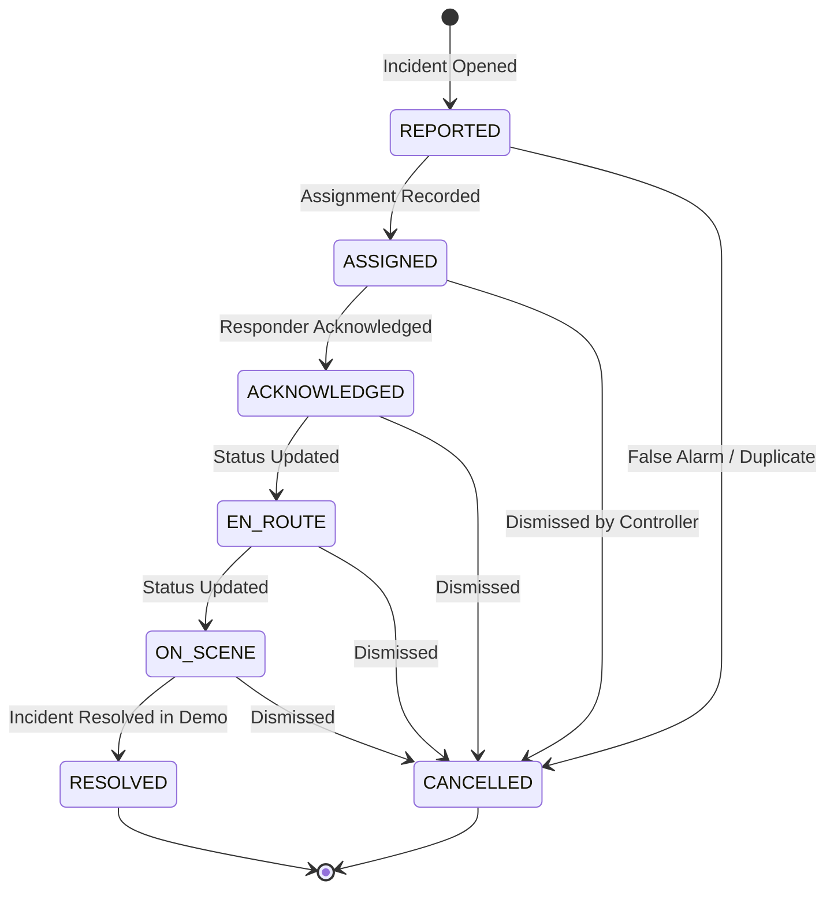

# Fire Department Simulator — Incident Response Console

[](https://flutter.dev/)
[](https://dart.dev/)
[](pubspec.yaml)
[](https://opensource.org/licenses/MIT)

The **Fire Department Simulator** is a Flutter client for demonstrating an incident-review workflow against a configured Air Health backend. It can show incident records, inspect attached evidence, and record allowed status changes. It is not a live emergency-dispatch application.

> **Simulation boundary**: Status changes are sent to the configured backend and may persist there. The app does not contact emergency services, send public alerts, or dispatch physical units. Any optional authority webhook is a separate backend configuration and is not implied to be active.

---

## 🏛️ Demonstration Incident Lifecycle



---

## 🚀 Key Capabilities

### 1. Incident Review Queue
- Polls the configured backend (`GET /api/v1/incidents`) for incident records visible to the configured actor.
- Filter by jurisdiction, priority (Low, Medium, High, Critical), and authority role (`fire_department` or `pollution_control`).
- In-app notifications when new assignments are returned by the backend. These do not notify anyone outside the app.

### 2. Evidence Inspection & Ground Truth
- Directly inspects citizen evidence photos attached to reports.
- Shows the initiating source when it is recorded on the incident.
- Displays exact geographic coordinates, corresponding H3 hexagonal cell index, and temporal timeline.

### 3. Strict State Machine & Idempotency
- Status progression follows strict server-validated transition tables:
  `REPORTED` ➔ `ASSIGNED` ➔ `ACKNOWLEDGED` ➔ `EN ROUTE` ➔ `ON SCENE` ➔ `RESOLVED`.
- All requests are safe from duplicate taps and network drops: action buttons disable during in-flight requests, and the server enforces idempotent status progression.

### 4. Published Alert Review
- The `pollution_control` simulator role can review published PM2.5 alerts from the latest spatial prediction run and create a simulated incident record for review.

### 5. In-App Diagnostics & Settings
- Comprehensive in-app **Settings Screen** allowing dynamic configuration of:
  - Backend Base URL
  - Simulator API Key (`X-Simulator-Key`)
  - Responder Actor ID (e.g. `fire-unit-7`)
  - Authority Role (`fire_department` vs `pollution_control`)
- Built-in **Test Connection** diagnostic that immediately isolates whether network unreachable errors or server key authentication rejections occur.

---

## ⚙️ Zero-Dependency Architectural Design

The application uses Dart's `dart:io` APIs and Flutter's core material components without third-party pub package dependencies. Its transport layer distinguishes network errors from HTTP responses and reports those errors in the UI.

---

## 📱 Pre-Built Release APKs

Ready-to-install Android release APKs are located in [`apks/`](../../apks/):

| Target Architecture | File Name | Size | Recommended For |
|---|---|---|---|
| **ARM 64-bit** | [`fire_dept_simulator-arm64.apk`](../../apks/fire_dept_simulator-arm64.apk) | **~19.4 MB** | **Modern Android phones** (recommended) |
| **ARM 32-bit** | [`fire_dept_simulator-arm32.apk`](../../apks/fire_dept_simulator-arm32.apk) | **~16.7 MB** | Older 32-bit Android devices |
| **x86_64** | `app-x86_64-release.apk` | **~20.9 MB** | Android Studio Emulators |
| **Universal** | [`fire_dept_simulator-release.apk`](../../apks/fire_dept_simulator-release.apk) | **~57.5 MB** | Universal fat APK |

### Install via ADB
```bash
adb install apks/fire_dept_simulator-arm64.apk
```

---

## ⚡ Running & Configuration

### Prerequisites
- **Flutter SDK**: `>=3.13.0`
- **Android Studio** / **Android SDK** (API 21+)

### Development Run
```bash
cd partner_apps/fire_dept_simulator
flutter pub get

# Run against default remote backend
flutter run

# Or provide environment configurations via dart-define:
flutter run \
  --dart-define=INCIDENT_API_BASE_URL=http://localhost:8000 \
  --dart-define=SIMULATOR_API_KEY=your-local-secret \
  --dart-define=SIMULATOR_ACTOR_ID=fire-unit-7 \
  --dart-define=SIMULATOR_ROLE=fire_department
```

*Note: For Android Emulators accessing the host machine's localhost, set `INCIDENT_API_BASE_URL=http://10.0.2.2:8000`.*

### Building Production APKs
```bash
flutter build apk --release --split-per-abi --obfuscate --split-debug-info=build/symbols
```

---

## 🧪 Testing

```bash
# Run static analysis
flutter analyze

# Run unit tests
flutter test
```
